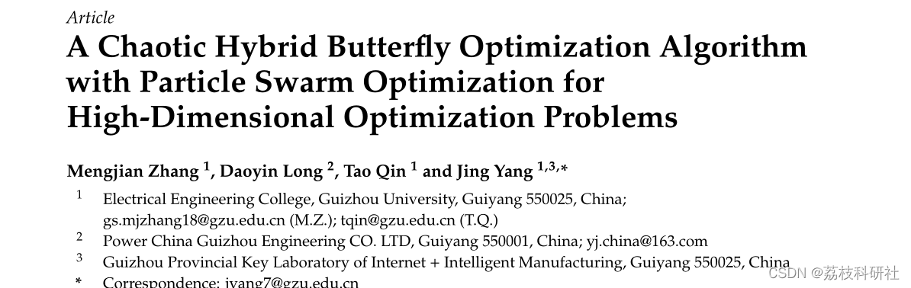
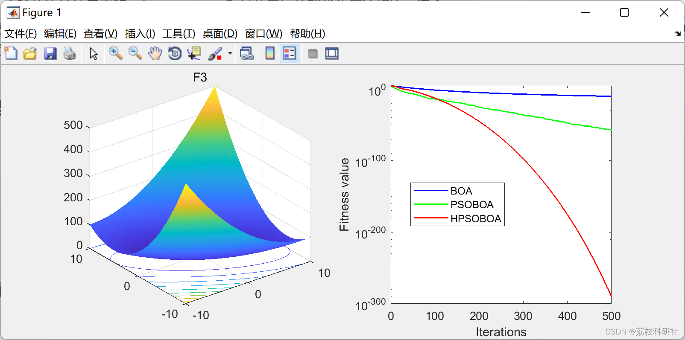
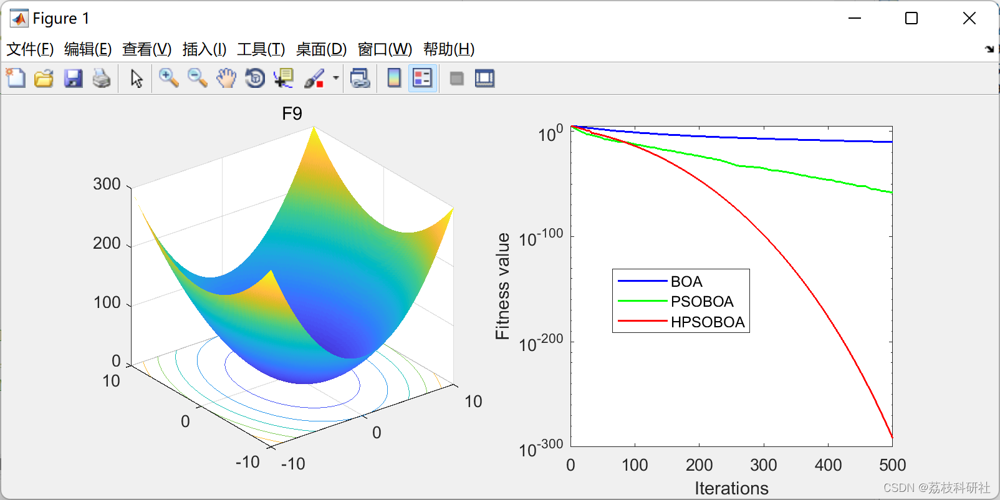
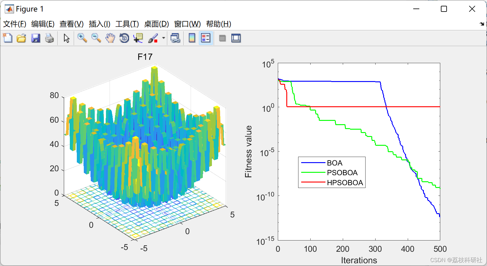
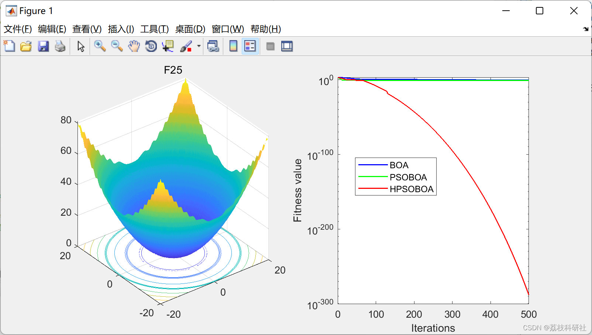

# Chaotic Particle Swarm Hybrid Butterfly Optimization Algorithm for High-Dimensional Optimization Problems (Matlab Code Implementation)

Editor
Abstract: To address the issues of low precision and slow convergence in Butterfly Optimization Algorithm (BOA), research trends are shifting towards the integration of two or more algorithms to achieve optimal solutions in the field of optimization problems. A new hybrid algorithm, namely HPSO-BOA, is proposed, along with three methods for improving the basic BOA. Therefore, the BOA initialization using a cubic one-dimensional mapping is introduced, and a nonlinear parameter control strategy is implemented. Furthermore, the Particle Swarm Optimization (PSO) algorithm is integrated with BOA to enhance the basic BOA for global optimization. Two experiments (including 26 well-known benchmark functions) were conducted to verify the effectiveness of the proposed algorithm.The comparative experimental results show that the hybrid HPSO-BOA algorithm has faster convergence speed and better stability compared to PSO, BOA, and other known group optimization algorithms in high-dimensional numerical optimization problems. Keywords: Butterfly Optimization Algorithm (BOA); Particle Swarm Optimization; Cubic Graph; Nonlinearity; High Dimensionality📚2 Run Results
function func_plot_con(func_name)
    [lb, ub, dim, fobj] = Hight_Get_Functions_details(func_name);
    switch func_name
        case 'F1'
            x = -100:2:100; y = x; % [-100,100]
        case 'F2'
            x = -10:0.2:10; y = x; % [-10,10]
        case 'F3'
            x = -10:0.2:10; y = x; % [-10,10]
        case 'F4'
            x = -10:0.5:10; y = x; % [-10,10]
        case 'F5'
            x = -10:0.5:10; y = x; % [-10,10]
        case 'F6'
            x = -1.28:0.05:1.28; y = x; % [-1.28,1.28]
        case 'F7'
            x = -10:0.5:10; y = x; % [-10,10]
        case 'F8'
            x = -1:0.01:1;y = x; % [-1,1]
        case 'F9'
            x = -10:0.1:10; y = x; % [-10,10]
        case 'F10'
            x = -10:0.1:10; y = x; % [-10,10]
        case 'F11'
            x = -5.12:0.1:5.12; y = x; % [-5,10]
        case 'F12'
            x = -5:0.05:5; y = x; % [-5,5]
        case 'F13'
            disp('Invalid function name');
    end
end
x=-100:2:100; y=x; %[-100,100]  
case 'F14'  
x=-100:2:100; y=x; %[-100,100]  
case 'F15'  
x=-10:0.1:10; y=x; %[-10,10]  
case 'F16'  
x=-5.12:0.1:5.12; y=x; %[-50,50]  
case 'F17'  
x=-5.12:0.1:5.12; y=x; %[-50,50]  
case 'F18'  
x=-20:0.05:20; y=x; %[-20,20]  
case 'F19'  
x=-600:5:600; y=x; %[-600,600]  
case 'F20'  
x=-10:0.2:10; y=x; %[-10,10]  
case 'F21'  
x=-10:0.1:10; y=x; %[-50,50]  
case 'F22'  
x=-5:0.05:5; y=x; %[-50,50]  
case 'F23'  
x=-2:0.02:2; y=x; %[-5,5]  
case 'F24'  
x=-1:0.01:1; y=x; %[-1,1]  
case 'F25'  
x=-20:0.2:20; y=x; %[-100,100]  
case 'F26'  
x=-5:0.2:5; y=x; %[-10,10]  
end  
L=length(x);  
f=[];  
for i=1:L  
for j=1:L  
f(i,j)=fobj([x(i),y(j)]);  
end  
end  
surfc(x,y,f,'LineStyle','none');  
% contour(x,y,f)  
% colormap winter  
colormap parula  
% colormap autumn  
% colormap summer  
end  
🌈3 Matlab code and detailed article explanation
🎉4 References
​  

## Images

<!-- PAYMENT_BLOCK -->

## Get this dataset

- Payment link (Stripe): [Buy now](https://buy.stripe.com/3cs8yP7sY87d0vu9AB)
- Payment QR code: 

<!-- /PAYMENT_BLOCK -->
